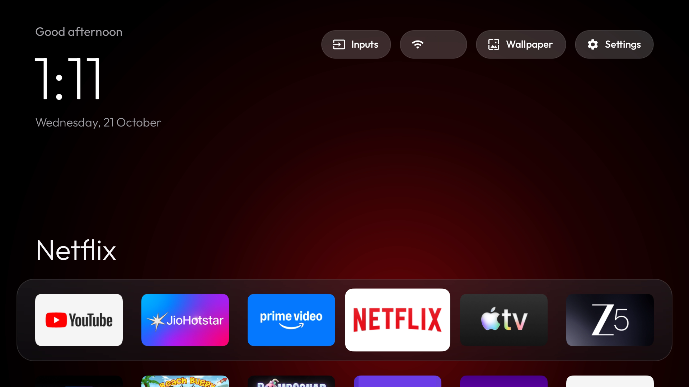
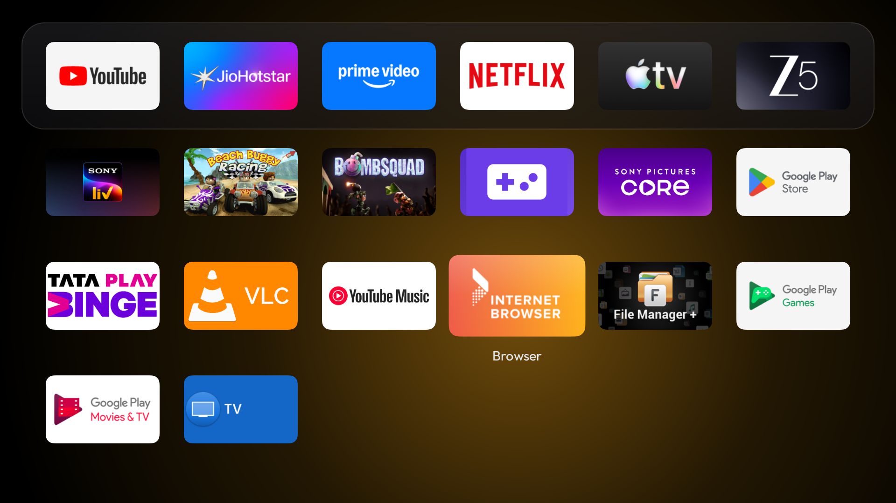
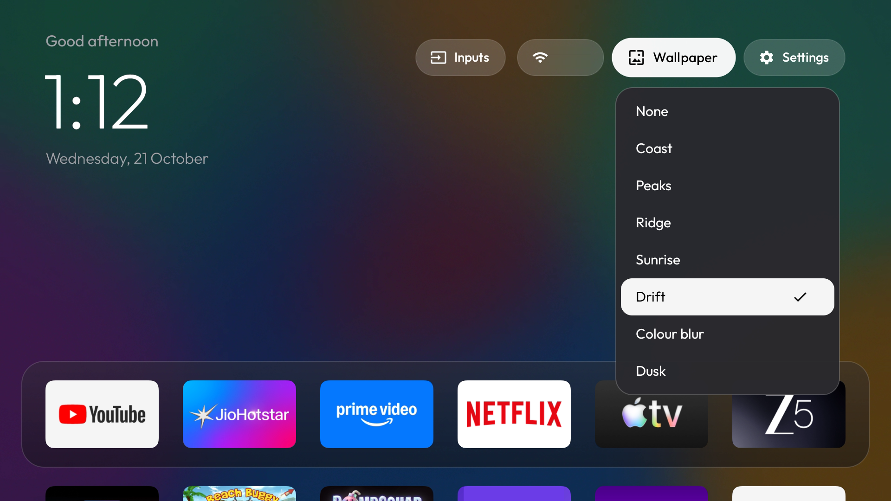

# BRAVIA TV: debloat + Apple TV style home screen

Sony BRAVIA KD-43X80L, Google TV, Android 12.



| App grid | Wallpaper picker |
| --- | --- |
|  |  |

## What was done

- Turned off tracking, ad and demo apps. Nothing was uninstalled. See `debloat-list.txt`.
- Kept every app you use, plus voice, Chromecast, AirPlay, DLNA and firmware updates.
- Set ad-blocking DNS (AdGuard). It does **not** block YouTube ads.
- Replaced the Google TV home screen with a small custom one (`launcher/`).
- Made the remote's Settings (gear) button work again. The old home screen used to handle it.

## Files

| Path | What it is |
| --- | --- |
| `CLAUDE.md` | Instructions for making changes with Claude Code: how to deploy to the TV, check it, and what to avoid |
| `build-and-install.sh` | Builds the home screen, installs it and makes it the Home app |
| `tools/restore.sh` | Undoes everything: re-enables all apps, gives Home back to Google TV, resets DNS |
| `tools/disable.sh` | Disables apps and logs them in `disabled-by-us.txt` (what `restore.sh` reads) |
| `tools/shot.sh` | Takes a screenshot from the TV into `shots/` (local only, not in the repo) |
| `tools/find-tv.py` | Finds the TV on your network and saves its address in `.tv-ip` (local only) |
| `tools/tv-env.sh` | Used by the other scripts to connect to the TV |
| `tools/adb-closed.py` | Checks that ADB on the TV is really closed |
| `tools/push-wallpapers.sh` | Copies wallpapers to the TV |
| `tools/make-wallpaper.py`, `tools/make-drift.py` | Make the colour-blur pictures and the Drift video |
| `wallpapers/` | The preloaded wallpapers |
| `disabled-by-us.txt` | Every package we disabled, one per line |
| `debloat-list.txt` | The same list with reasons |
| `backup/` | Package lists, settings and properties from before any change (local only, not in the repo: it holds the TV's serial number and IDs) |
| `launcher/` | The home screen source (Java, Android Studio / Gradle project) |

## Making changes

Open Claude Code in this folder and ask for the change. `CLAUDE.md` tells it how to build, put the change on the TV, check it with screenshots, and what not to break. A new session needs no memory of earlier ones.

By hand, it's two commands:

```sh
python3 tools/find-tv.py      # once, or whenever the TV's IP changes
./build-and-install.sh        # puts the current code on the TV
```

Your app layout, hidden apps and wallpaper stay as they are when you reinstall.

The plain `adb ...` commands further down work once the Mac is connected to the TV. Any script above connects it.

## ADB (how the Mac talks to the TV)

ADB is left **on**, so changes can be put on the TV any time it's on. It survives restarts.

Is that safe? On your own home Wi-Fi, yes, with one rule:

- **Never accept an "Allow USB debugging?" box you didn't expect.** Any device on your Wi-Fi can make that box appear, but it only gets in if someone presses Allow on the TV. Press Cancel if you didn't start it.
- Only this Mac is approved. If it isn't used for 7 days, the TV asks once more next time (Android's default). Accept it then.
- ADB traffic on the network isn't encrypted. Someone already on your Wi-Fi could watch a session while one is running, but couldn't start one.
- If you ever put the TV on a shared or public network (office, hotel), turn ADB off first.
- If an app ever refuses to play because "developer options" are on, turn USB debugging off for that app.

To turn ADB off: on the TV, Settings > System > Developer options > tap "Revoke USB debugging authorisations", turn off **USB debugging**, then restart the TV. Check from the Mac with `python3 tools/adb-closed.py <tv-ip>`; only "CLOSED" proves it's off.

To turn it back on:

1. On the TV: Settings > System > About > press OK 7 times on "Android TV OS build" (just "Build" on some versions).
2. Back to Settings > System > Developer options > turn on **USB debugging** (and Network debugging, if your TV shows it).
3. On the Mac: `python3 tools/find-tv.py`, then accept the "Allow USB debugging?" box on the TV and run it again.

## Turn one app back on

```sh
adb shell pm enable <package.name>
```

Or on the TV: Settings > Apps > See all apps > Show system apps > pick the app > **Enable**.

Package names are in `debloat-list.txt`.

## Undo everything

```sh
tools/restore.sh
adb uninstall com.viraj.tvhome      # optional: remove the custom home screen
```

## Rearrange, hide and bring back apps (on the TV)

Hold **OK** on any app for about half a second. A small menu opens:

- **Move**: the app lifts and the others dim. Arrows swap it with the app next to it, also into or out of the dock. Press **OK** or **Back** when done.
- **Hide**: removes the app from the home screen. It stays installed and enabled. If it was in the dock, the next app moves up.
- **Hidden apps (N)**: only shows when something is hidden. Pick an app and press **OK** to bring it back to its old spot.

A short press of OK opens an app when you let go of the button.

The dock is always the first 6 apps (6 per row, like the grid). Your layout is saved on the TV and survives restarts. New apps you install appear at the end of the grid.

### Start over from the default layout

`dock_packages` in `launcher/app/src/main/res/values/config.xml` lists the apps that come first, left to right; the next apps A to Z fill the rest of the 6 dock slots. It is only used until you move something. To go back to it:

```sh
adb shell pm clear com.viraj.tvhome
./build-and-install.sh
```

This also deletes the wallpapers on the TV. Run `tools/push-wallpapers.sh` afterwards to put them back.

To find an app's package name:

```sh
adb shell pm list packages | grep -i <part of the name>
```

## Wallpapers

Pick one on the TV: go up to the top bar, open **Wallpaper**, choose one and press **OK**. The list shows **None** first, then videos, then pictures, each A to Z. A number at the start of a file name (`1-drift.mp4`) moves it below the others of its kind; the number isn't shown.

- **None** is the default look: black, with a soft glow in the colour of the focused app.
- Any other choice replaces the glow and gets a light dark tint (30%) so the text stays readable.
- Videos play muted. They stop the moment you open an app (so it gets the video decoder) and continue where they left off when you come back.

Preloaded (in `wallpapers/`; Apple's videos are not in the repo, see below):

| On the TV | File | What it is |
| --- | --- | --- |
| Coast | `coast.mp4` | Apple's aerial of a tropical coastline, 9 min, converted to 1080p 60 fps (316 MB). For your own TV only; don't share it. |
| Drift | `1-drift.mp4` | Dark colour patches slowly drifting, 60 s seamless loop (21 MB). Made by `tools/make-drift.py`. |
| Peaks | `peaks.mp4` | Apple's aerial of sunlit snowy peaks over blue valleys, 5.5 min (110 MB). For your own TV only. |
| Ridge | `ridge.mp4` | Apple's aerial of a snow-capped range above the clouds, 2.5 min (72 MB). For your own TV only. |
| Sunrise | `sunrise.mp4` | Apple's aerial of a golden sunrise over a misty river, 10 min (272 MB). For your own TV only. |
| Colour blur | `colour-blur.jpg` | Brighter tvOS-style colour blur. `python3 tools/make-wallpaper.py wallpapers/colour-blur.jpg` |
| Dusk | `dusk.jpg` | Dark, calm colour blur. `python3 tools/make-wallpaper.py wallpapers/dusk.jpg 0.45` |

Coast, Peaks, Ridge and Sunrise are Apple TV aerial screensavers, so they're left out of this repo. Download your own copies and convert them with the command below.

### Add a wallpaper

Pictures (`.jpg`, `.png`, `.webp`) and videos (`.mp4`, `.mkv`, `.webm`, `.mov`) work. The file name becomes the name in the list (`night-sky.jpg` shows as "Night sky").

```sh
tools/push-wallpapers.sh my-picture.jpg     # one file
tools/push-wallpapers.sh                    # everything in wallpapers/
```

Big or high-frame-rate videos (like Apple's 4K 240 fps originals) need converting first. This is how Coast was made:

```sh
ffmpeg -hwaccel videotoolbox -i original.mov \
  -vf "fps=60000/1001,scale=1920:1080:flags=lanczos,format=yuv420p" \
  -c:v hevc_videotoolbox -profile:v main -b:v 5M -maxrate 7M -bufsize 10M -g 120 \
  -tag:v hvc1 -an -movflags +faststart wallpapers/my-video.mp4
```

### Remove a wallpaper from the TV

Pick **None** to stop using it. To delete the file and free the space:

```sh
adb shell rm /sdcard/Android/data/com.viraj.tvhome/files/wallpapers/coast.mp4
```

If the deleted one was in use, the TV goes back to **None** by itself.

## Remote buttons

- App buttons (YouTube, JioHotstar, Netflix, Prime Video), Input, mic, volume and channels: handled by Sony. Untouched.
- Settings (gear): handled by the home screen's "Home remote keys" service. It opens Settings.
  - It matches the button by scan code `646` (`settings_key_scancodes` in `config.xml`).
  - To check it is on: `adb shell dumpsys accessibility | grep "Bound services"`.
  - If the button stops working after a reset, run `./build-and-install.sh` again.

## Ad-blocking DNS

- On: `adb shell settings put global private_dns_specifier dns.adguard-dns.com` then `adb shell settings put global private_dns_mode hostname`
- Off: `adb shell settings put global private_dns_mode opportunistic`
- If an app ever fails to load, turn it off and try again.

## Good to know about this TV

- **Live TV** in the Inputs menu opens Sony's TV app. There are no antenna channels saved, so it shows your last input (your Cable box).
- **Double-pressing Home** jumps back to the last app. That's Sony, not the home screen.
- **RetroPal** claims every "open this" link on the TV. That's why the home screen sends input switches straight to Sony's TV app.
- **Screenshots** of HDMI, Live TV or Netflix come back empty (0 bytes). That's the TV protecting video, not a fault.
- **This TV's renderer** cuts a scaled view to its original size. So the home screen scales whole tiles (with spare padding) instead of only the picture.
